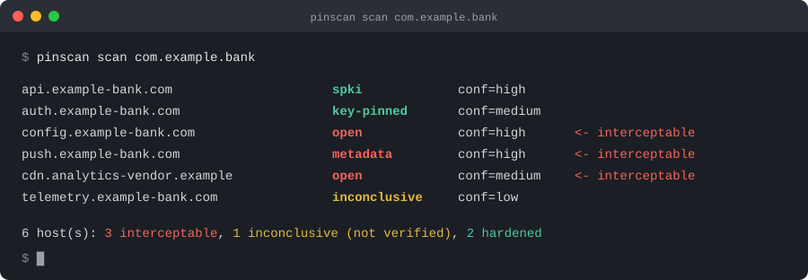

<p align="center">
  <picture>
    <source media="(prefers-color-scheme: dark)" srcset="docs/assets/logo-dark.svg">
    
  </picture>
</p>

<p align="center">
  <b>Measure which endpoints of a mobile app actually pin their TLS certificates, how well, and how sure you can be.</b><br>
  No Frida, no hooks, no repackaging. Never "secure" from silence.
</p>

<p align="center">
  <a href="https://github.com/yinkoshield/pinscan/releases/latest"></a>
  <a href="https://github.com/yinkoshield/pinscan/actions/workflows/ci.yml"></a>
  <a href="https://pkg.go.dev/github.com/yinkoshield/pinscan"></a>
  <a href="go.mod"></a>
  <a href="LICENSE"></a>
  <a href="SECURITY.md"></a>
</p>

<p align="center">
  <a href="#installation">Installation</a> •
  <a href="#quickstart">Quickstart</a> •
  <a href="#how-it-works">How it works</a> •
  <a href="#built-for-ci">CI</a> •
  <a href="#what-pinscan-does-not-do">Limits</a> •
  <a href="#documentation">Documentation</a> •
  <a href="CONTRIBUTING.md">Contributing</a>
</p>

<p align="center">
  
</p>

<p align="center"><sub>Built by the <b>YinkoShield Threat Lab</b> (Yinkozi Group), the team behind our research on malware targeting Africa's financial apps.</sub></p>

Every mobile banking review says "the app implements certificate pinning". pinscan
replaces that sentence with a measurement. It makes a test device trust a research
CA, presents the app with three forged certificates of increasing fidelity, and
records what the app accepts, per host. The login API above rejects every forgery.
The configuration, push and analytics hosts the same app talks to on startup do
not, and an attacker holding any certificate the device trusts reads and modifies
all three.

We built it because our threat research kept finding apps whose security review
said "pinned" and whose startup traffic said otherwise, and the tools we had
could not tell a pinned host from one that simply made no request. We wanted a
measurement that is honest about what it did not see, that a developer can act
on, and that CI can re-run on every release.

- **Per-host verdicts on a strength scale**, from `open` to `spki` (every
  forged chain rejected), with the evidence behind each one carried into the
  report. Verdicts describe what the app did, not the mechanism that did it.
- **Separates key pinning from name checking.** A wave that clones the real
  issuer's name under our CA passes name-based "pinning" and fails real pinning.
  A plain MITM proxy cannot tell them apart.
- **Never reports "hardened" because it saw nothing.** A timeout, a reset or a
  silent connection is `inconclusive`, counted and shown, never a pass.
- **Never reports "hardened" because the test was broken.** A client that does
  not trust the research CA rejects every forged chain exactly like a pinned
  one. pinscan verifies the CA from inside the app's own mount namespace before
  a rejection counts, and withholds hardened verdicts when it cannot.
- **Confidence is a separate axis.** A one-shot `spki` and a well-evidenced
  `spki` are not the same thing, and CI can demand the latter.
- **Gets past a pinned front door without lying about it.** `-passthrough`
  relays a named host (a key-pinned login API, say) to its real server
  untouched, so the app logs in and exposes the hosts behind it. The relayed
  host is reported as not tested, never as hardened; `-passthrough '*'` relays
  everything and only lists what the app contacts.
- **Built for pipelines.** Exit codes that tell a broken scan from a policy
  breach, byte-stable JSON baselines, a regression gate, a policy file with
  mandatory reasons, SARIF and JUnit output.
- **Nothing to trust blindly.** Open Magisk module in plain shell, Zygisk module
  source included, pure classifier with its rules in a test table, and a
  `selftest` that proves the methodology without a device.

> [!IMPORTANT]
> **Authorized use only.** Test devices and apps you own or are explicitly
> authorized to assess. pinscan is a posture-evaluation tool, not an interception
> tool for third-party traffic. See [SECURITY.md](SECURITY.md).

## Installation

```sh
# Go 1.26+ (an older Go downloads the right toolchain automatically)
go install github.com/yinkoshield/pinscan/cmd/pinscan@latest
```

Prebuilt binaries for Linux, macOS and Windows, with `SHA256SUMS` and a
CycloneDX SBOM, are on the [releases page](https://github.com/yinkoshield/pinscan/releases/latest).
From a clone, `make build` writes `./bin/pinscan`.

For Android you also need `adb` on the host and a **rooted** device (Magisk) on
the same LAN. Any other TLS client works with the `manual` driver.

## Quickstart

```sh
pinscan selftest                   # proves the methodology end to end; no device needed
pinscan ca-new                     # creates the research CA at ~/.pinscan/ca.pem
pinscan ca-module -o pinscan-ca    # generates an open Magisk module that trusts it (push + reboot)
pinscan doctor com.example.app     # checks every prerequisite and prints the fix for each
pinscan scan com.example.app -report scan.html
```

> [!TIP]
> Run `pinscan selftest` first. It mints the certificates, runs the proxy and the
> classifier against six in-process clients with known postures, including one
> that does not trust the research CA and one relayed untouched, and asserts
> each verdict. If it passes,
> the methodology works on your machine. The same proof on a real device, against
> Network Security Config, OkHttp, a custom TrustManager, WebView and three broken
> setups, is the [validation matrix](docs/validation.md): a small test app plus
> `scripts/validate-device.sh`.

Step by step, including rooting, the two CA-trust modes and finding the package
name: [Getting started](docs/getting-started.md). No hardware?
[Try it on an emulator](docs/emulator.md).

## How it works

Three waves, each signed by the research CA the device trusts:

| Wave | Certificate presented | Acceptance reveals |
|:----:|-----------------------|--------------------|
| **A** | a generic leaf for the hostname | no pinning at all |
| **B** | a leaf cloning the real certificate's subject and SANs, with our key | the app checks names, not keys |
| **C** | that leaf under an intermediate whose name clones the real issuer | the app checks the chain's names, not keys |

No forgery ever uses the real endpoint's key. That is exactly what public-key
pinning detects, and exactly what name-based checks miss.

| Verdict | Meaning | Defeated by a trusted-CA attacker |
|---------|---------|:---:|
| `open` | sent a request over the generic leaf | yes |
| `metadata` | rejected the generic leaf, accepted the cloned names | yes |
| `name-validation` | rejected both leaves, accepted the cloned-issuer chain | yes |
| `key-pinned` | rejected the forged leaves; wave C did not separate a key check from issuer-name validation | not established |
| `spki` | rejected everything, including the cloned issuer | no |
| `inconclusive` | no usable signal | not established |

"not established" is not a weaker "no". A `key-pinned` host rejected two
forgeries, but the one wave that tells a key check from a name check returned
no usable signal, so the scan did not determine whether a trusted-CA attacker
defeats it. The tally counts it as undetermined, not hardened; re-run until
wave C decides before recording the host as hardened.

Three rules keep the verdicts honest, and all three are in the code, not the docs:

- **Acceptance requires an observed request**, not a completed handshake. An app
  can finish the handshake and refuse at the application layer, as OkHttp's
  `CertificatePinner` does. A handshake with no request is `inconclusive`.
- **Only a certificate-class TLS alert counts as a rejection.** `bad_certificate`,
  `unknown_ca` and friends. A timeout, a reset or a non-certificate alert is
  `inconclusive`, never "hardened".
- **A rejection counts only if the client trusted the research CA.** On Android,
  pinscan verifies the CA by content from inside the zygote or the app's own
  mount namespace, refuses to scan when it is absent, and withholds `spki` and
  `key-pinned` as `inconclusive` when it could not check. The report records
  `ca_trust` as `verified`, `unverified` or `operator-asserted` (manual driver).

Every verdict carries a confidence (`low`, `medium`, `high`) from how many
consistent attempts backed it. Full detail: [Methodology](docs/methodology.md).

## Built for CI

Commit a baseline, then fail the pull request that weakens a host:

```sh
pinscan baseline com.example.app -o baselines/com.example.app.json   # commit this
# -passthrough: a key-pinned login API is relayed untouched so the app gets past
# it; that host is not tested and reads inconclusive.
pinscan scan com.example.app -baseline baselines/com.example.app.json \
  -policy .pinscan.yaml -fail-on-regression -fail-on-interceptable \
  -passthrough login.example.com \
  -report findings.sarif -log-format json
```

| Exit | Meaning | Pipeline action |
|:----:|---------|-----------------|
| `0` | no policy violation | pass |
| `2` | the device, CA or proxy could not complete the scan | retry or alert, do not block |
| `3` | an interceptable host | block |
| `4` | regression against the baseline | block |
| `5` | incomplete coverage or confidence below `-min-confidence` | investigate |

Baselines are canonical JSON: no timestamps, sorted keys, byte-stable, reviewable
as a diff. Regression is defined on the lattice
`open < metadata < name-validation < key-pinned < spki`; a host that falls to
`inconclusive` is flagged for review, never silently passed. Reports come as
JSON (versioned schema), Markdown, self-contained HTML, SARIF for the GitHub
Security tab, and JUnit. Details: [CI integration](docs/ci.md),
[Output formats](docs/output.md).

## What pinscan does not do

- **It does not identify the mechanism.** `spki` means the app resists a
  trusted-CA attacker under these parameters. Whether that is an SPKI pin set, a
  private trust store or Certificate Transparency enforcement is a
  reverse-engineering follow-up.
- **Post-handshake pinning reads `inconclusive`, not `spki`.** OkHttp-style
  pinners complete the handshake and send nothing. pinscan cannot distinguish
  that from an app that made no request, and says so. Network Security Config
  pin sets reject during the handshake and read `spki`. Both are rows of the
  [validation matrix](docs/validation.md), which also lists what a `spki` does
  not prove (a pin set that matches nothing reads the same).
- **It needs a rooted device**, or a client whose trust store you control. Apps
  with active runtime protection that refuse to run rooted need a managed
  runtime, offered by YinkoShield as an engagement and not part of this repo.
- **It is not a traffic interceptor.** `-capture` is for the startup,
  unauthenticated surface only; credential headers are redacted and bodies
  capped regardless.

## Documentation

| Guide | Answers |
|-------|---------|
| [Getting started](docs/getting-started.md) | install to first scan, step by step |
| [Methodology](docs/methodology.md) | the three waves, the verdicts, confidence, and why silence is never "secure" |
| [Scanning Android](docs/android.md) | rooting, system vs scoped CA trust, proxy vs transparent routing, what is changed on the device and reverted |
| [Trying it on an emulator](docs/emulator.md) | a no-hardware walkthrough |
| [Scanning anything else](docs/non-android.md) | the `manual` driver for desktop, server-side and IoT TLS clients |
| [Command reference](docs/commands.md) | every subcommand and flag, and each `doctor` check |
| [Output formats](docs/output.md) | the JSON contract, captured exchanges, HAR dumps, SARIF and JUnit mapping |
| [CI integration](docs/ci.md) | exit codes, baselines, the policy file, a GitHub Actions example |
| [Validation matrix](docs/validation.md) | the expected verdict per known client posture and per broken setup, and the kit that checks them on a device |
| [Troubleshooting](docs/troubleshooting.md) | the failures people actually hit, with fixes |
| [Architecture](docs/architecture.md) | package layout and data flow, for contributors |

Package documentation is standard godoc: `go doc ./internal/<pkg>`.

## Build and test

```sh
make tools    # install the pinned golangci-lint
make          # fmt + strict lint + race tests + build → ./bin/pinscan
make repro    # prove the build is reproducible (build twice, byte-compare)
make dist     # cross-build release binaries + SHA256SUMS
```

The scoped-mode Zygisk module ships as source in
[`android/ykzpinscan/`](android/ykzpinscan/) with a prebuilt arm64 `.so`; rebuild
it with the Android NDK via `build.sh`. Releases are cut with
[goreleaser](.goreleaser.yaml). The engineering bar (test-first, strict lint,
pure classifier, coverage honesty) is in [ENGINEERING.md](ENGINEERING.md).

## Acknowledgements

The approach builds on Google's nogotofail (2014), the Spinner work of
McMahon Stone, Chothia and Garcia (2017) and the pinning measurement pipeline
of Pradeep et al. (IMC 2022). What pinscan takes from each, and what it adds,
is in [Methodology](docs/methodology.md#related-work).

## Contributing and security

Pull requests are welcome; read [CONTRIBUTING.md](CONTRIBUTING.md) first. Report
vulnerabilities privately as described in [SECURITY.md](SECURITY.md), never in a
public issue. Release notes are in [CHANGELOG.md](CHANGELOG.md).

## License

Apache License 2.0; see [LICENSE](LICENSE) and [NOTICE](NOTICE). The scanner,
methodology, self-test and trust modules are the open part. "YinkoShield" and
"Yinkozi" are names of Yinkozi Group and the license grants no right to use them.

<p align="center"><sub>Built by the <b>YinkoShield Threat Lab</b>, Yinkozi Group.</sub></p>
